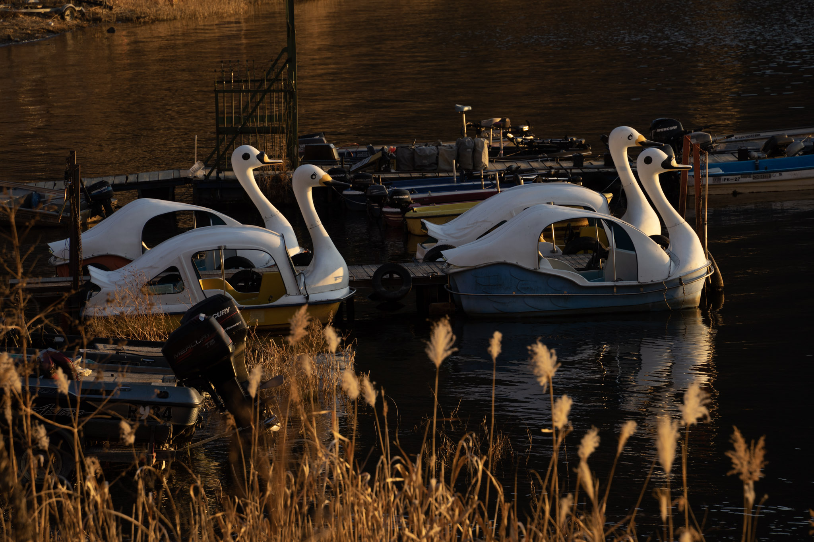
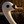

<style>
  @import url("../../markdown.css");
</style>

## Overview

The `unwrap-images` plugin removes the `<p>` wrapper that Markdown adds around standalone images, allowing images to render as direct block-level elements. Images inside links are also unwrapped.

**Before:**
```html
<p></p>
```

**After:**
```html

```

## Syntax

Any image that stands alone on a paragraph — with no other text or inline content — is unwrapped:

% Demo
> 
>
> Images mixed with text are **not** unwrapped:
>
> Here is an inline image:  within a sentence.
% Code
> ````markdown
> 
>
> Images mixed with text are **not** unwrapped:
>
> Here is an inline image:  within a sentence.
> ````

A paragraph of several images, with only spaces or line breaks between them, is unwrapped too. So is a [lightbox](/guide/plugins/lightbox) image, whose trigger button takes the paragraph's place.

## Attributes

A paragraph's attributes are not lost with it. When the paragraph holds one image, every attribute the paragraph carries goes on the ``: the id, classes and other attributes an [attrs](/guide/plugins/attrs) block on the line after the image gives it, and the id a [block-ids](/guide/plugins/block-ids) marker gives it. The `` takes them inside a link or a lightbox button too, so a link to the paragraph's id still finds the image.

% Demo
> 
> {#swan}
>
>  ^swan
>
> [Jump to the first swan](#swan), or [to the second](#^swan).
% Code
> ````markdown
> 
> {#swan}
>
>  ^swan
>
> [Jump to the first swan](#swan), or [to the second](#^swan).
> ````

```html


<p><a href="#swan">Jump to the first swan</a>, or <a href="#%5Eswan">to the second</a>.</p>
```

The image's own attributes win: an id written on the image (`{#own}`) stays and the paragraph's is dropped, and the same goes for any other attribute both have. Classes add up, the image's own first and each once: `{.c}` with `{.wide}` on the next line renders `class="c wide"`. The paragraph's other attributes follow the image's own, in the order they were written.

A paragraph that carries an attribute and holds several images is not unwrapped: an id can name only one element, and a class on a group of images, such as `{.gallery}`, is about the group. It renders as it would without this plugin, `<p class="gallery"> </p>`. Several images in a paragraph with no attribute are unwrapped as before.

## Usage

> [!NOTE]
> The remark package ships a rehype plugin, not a remark plugin: add it **after** `remarkRehype` in your pipeline. In every engine, list the lightbox plugin before this one if you use both: listed after it, a lightbox image keeps its paragraph.

% Rehype
> ```sh
> npm install @mirrordown/remd-unwrap-images
> ```
%% Unified
> ```ts
> import { unified } from "unified";
> import remarkParse from "remark-parse";
> import remarkRehype from "remark-rehype";
> import rehypeStringify from "rehype-stringify";
> import { rehypeUnwrapImages } from "@mirrordown/remd-unwrap-images";
>
> const processor = unified()
>   .use(remarkParse)
>   .use(remarkRehype)
>   .use(rehypeUnwrapImages)
>   .use(rehypeStringify);
> ```
%% Astro
> ```ts
> // astro.config.ts
> import { defineConfig } from "astro/config";
> import { rehypeUnwrapImages } from "@mirrordown/remd-unwrap-images";
>
> export default defineConfig({
>   markdown: {
>     rehypePlugins: [rehypeUnwrapImages],
>   },
> });
> ```
% Markdown-It
> ```sh
> npm install @mirrordown/mdit-unwrap-images
> ```
%% Standalone
> ```ts
> import MarkdownIt from "markdown-it";
> import { unwrapImages } from "@mirrordown/mdit-unwrap-images";
>
> const md = new MarkdownIt().use(unwrapImages);
> ```
%% VitePress
> ```ts
> // .vitepress/config.ts
> import { defineConfig } from "vitepress";
> import { unwrapImages } from "@mirrordown/mdit-unwrap-images";
>
> export default defineConfig({
>   markdown: {
>     config: (md) => md.use(unwrapImages),
>   },
> });
> ```
% Sätteri
> ```sh
> npm install @mirrordown/sat-unwrap-images
> ```
%% Standalone
> ```ts
> import { markdownToHtml } from "satteri";
> import { satteriUnwrapImages } from "@mirrordown/sat-unwrap-images";
>
> const { html } = markdownToHtml(source, {
>   hastPlugins: [satteriUnwrapImages()],
> });
> ```
%% Astro
> ```ts
> // astro.config.ts
> import { defineConfig } from "astro/config";
> import { satteri } from "@astrojs/markdown-satteri";
> import { satteriUnwrapImages } from "@mirrordown/sat-unwrap-images";
>
> export default defineConfig({
>   markdown: {
>     processor: satteri({ hastPlugins: [satteriUnwrapImages()] }),
>   },
> });
> ```
