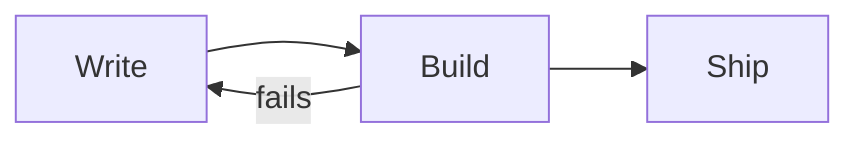
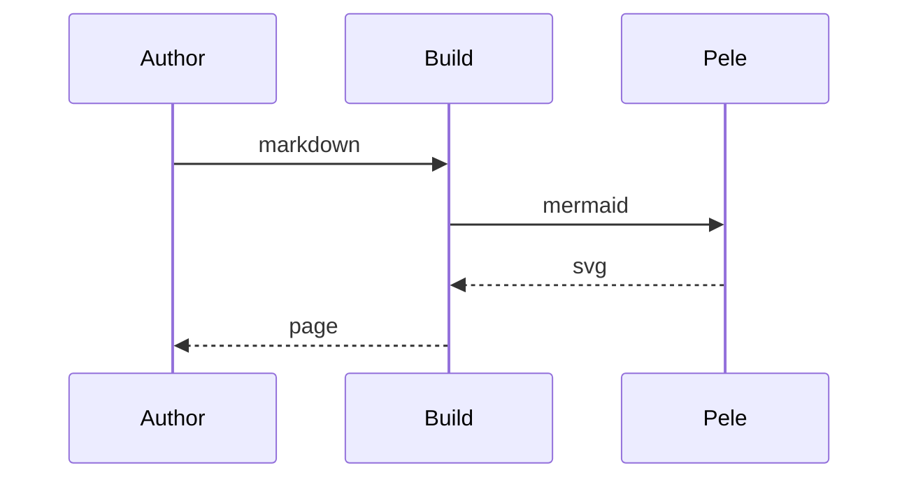
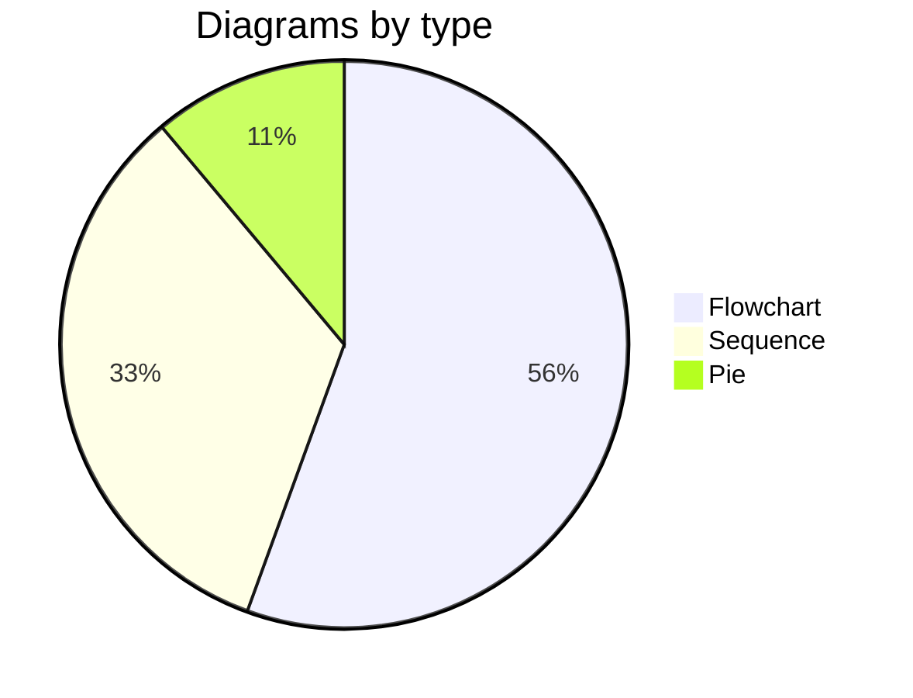
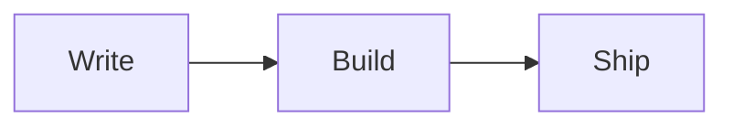
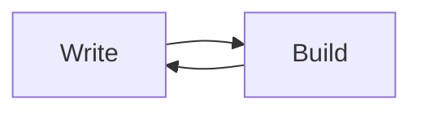

# @mirrordown/sat-mermaid-pele

> Part of [Mirrordown](https://github.com/mirrordown/mirrordown) — a suite of markdown syntax extensions for the unified, markdown-it and Sätteri ecosystems.

A Sätteri plugin for the `mermaid-pele` syntax extension.

## Overview

The `mermaid-pele` plugin renders ` ```mermaid ` code blocks to inline SVG while your site builds, with [Pele](https://pele.run), a small, fast Mermaid renderer from the makers of Obsidian. Pele has no dependencies, runs synchronously and needs no browser, so diagrams render in every engine with **no JavaScript on the page** and no headless browser in your build, and they work where scripts don't run, such as the VSCode Markdown preview.

The `<svg>` replaces the code block:

```html
<svg xmlns="http://www.w3.org/2000/svg" class="pele pele-flowchart" viewBox="0 0 160 64" width="160" height="64" style="max-width:100%;height:auto;…" role="graphics-document document" aria-roledescription="flowchart">…</svg>
```

The plugins follow [rehype-mermaid](https://github.com/remcohaszing/rehype-mermaid)'s API and find diagrams as it does, rendering them with Pele instead of Mermaid.js. Pele reads [Mermaid 12.1 syntax](https://pele.run/compatibility) for every built-in diagram type, but lays diagrams out with its own engine, so they look different from Mermaid's, and it themes them with CSS variables rather than Mermaid's themes.

## Syntax

Write a fenced code block with the language `mermaid`:

````markdown

````

In renderers without the plugin, the diagram stays a code block.

The language is case-sensitive and must be the first word of the info string: ` ```Mermaid ` and ` ```mermaidjs ` stay code blocks, and anything after `mermaid` is ignored. Indented code blocks are never rendered.

### Every diagram type

Sequence, class, state, entity relationship, Gantt, pie and every other diagram type built into Mermaid 12.1 renders. [Front matter](https://mermaid.js.org/config/configuration.html#frontmatter-config) and `%%{init}%%` directives configure a diagram as in Mermaid.

````markdown



````

### Accessible names

`accTitle` and `accDescr` become the SVG's `<title>` and `<desc>`, which the `<svg>` points to with `aria-labelledby` and `aria-describedby`, so screen readers announce the diagram by name.

````markdown

````

### Attributes

With the [`attrs`](/guide/plugins/attrs) plugin, attributes on the fence go on the `<svg>`: classes after Pele's own, a `style` after Pele's (which holds the theme variables), and anything else as written.

````markdown

````

```html
<svg xmlns="http://www.w3.org/2000/svg" class="pele pele-flowchart wide" … id="build-loop">…</svg>
```

### Ids

Pele names the ids it writes (a title, a gradient) after an id prefix, which the plugins set per diagram: the `prefix` option (`mermaid` by default), then a hash of the diagram's source, so a diagram's ids don't change when you edit another. A diagram repeated on a page gets `-2`, `-3`… after its hash, so no two diagrams share an id.

### Links

`click` statements link a node with a URL; JavaScript callbacks are ignored. Pele keeps `http`, `https`, `mailto` and `tel` links and relative URLs, adds `rel="noopener"`, and drops anything else, such as `javascript:` (see [Pele's security notes](https://pele.run/security)).

## Theming

Pele colors a diagram with CSS variables, read on the `<svg>` or any ancestor, and falls back to a light theme without them. The stylesheet defines them from your page's `Canvas` and `CanvasText` [system colors](https://developer.mozilla.org/docs/Web/CSS/system-color), so diagrams follow the nearest `color-scheme`: set `color-scheme: light dark` on `:root` to follow the reader's preference, and diagrams switch without re-rendering.

Its rules live in `@layer markdown-mermaid-pele`, so any unlayered CSS you write overrides them. Set Pele's variables on the diagrams or an ancestor:

| Property             | Default                    | Description                        |
| -------------------- | -------------------------- | ---------------------------------- |
| `--pele-bg`          | `Canvas`                   | Background, behind edge labels.    |
| `--pele-fg`          | 88% `CanvasText` | Text.                              |
| `--pele-muted`       | 57% `CanvasText` | Secondary text.                    |
| `--pele-line`        | 88% `CanvasText` | Edges and arrowheads.              |
| `--pele-surface`     | 5% `CanvasText` | Node fill.                         |
| `--pele-surface-alt` | 10% `CanvasText` | Subgraph fill.                     |
| `--pele-border`      | 46% `CanvasText` | Node and subgraph borders.         |
| `--pele-accent`      | blue, lighter in the dark  | Highlights.                        |

```css
.content {
  --pele-bg: #fffcf0;
  --pele-fg: #100f0f;
  --pele-font: "Inter", sans-serif;
}
```

Pele has more variables (series colors for charts, `--pele-radius`, `--pele-font`) and a class on every part of a diagram (`.pele-node`, `.pele-edge`, `.pele-label`…); see [Pele's theming guide](https://pele.run/theming). Colors a diagram sets itself with `style`, `classDef` or `linkStyle` stay fixed.

Pele sizes labels from a table of character widths when it renders without a browser, as it does here. If your diagrams use a font much wider or narrower than a typical sans-serif, pass its name as `fontFamily` and set `--pele-font` to match.

## Options

Every option is optional.

| Option          | Default     | Description                                                                                                                                                                                         |
| --------------- | ----------- | --------------------------------------------------------------------------------------------------------------------------------------------------------------------------------------------------- |
| `prefix`        | `"mermaid"` | The start of each diagram's id prefix.                                                                                                                                                              |
| `errorFallback` | none        | Called when a diagram fails to render. What it returns replaces the diagram; if it returns nothing, the diagram is removed. Without it, the build fails.                                             |
| `config`        | none        | Default Mermaid configuration; a diagram's front matter and `%%{init}%%` directives override it.                                                                                                     |
| `now`           | the time    | "Today" in Gantt charts. Pass a fixed date for builds that don't change from day to day; Gantt dates are local time, so give a local date (`new Date(2026, 0, 8)`).                                   |
| …               |             | Pele's other [render options](https://pele.run/api): `fontFamily`, `fontSize`, `responsive`, `maxWidth`, `padding`, `limit`, `maxEdges`, `linkSchemes`, `imageSchemes`, `links`, `images`, `icons`, `math` and the rest. |

`errorFallback` receives the engine's own node: markdown-it's fence token (return an HTML string), rehype's `<pre>` element and the file (return a hast node, as in rehype-mermaid), or Sätteri's `<pre>` element and the visitor's context (return a hast node).

### Errors

A diagram Pele can't render fails the build, with Pele's message and the line in your document where it found the problem:

```text
Could not render the mermaid diagram on line 5: Parse error on line 2:
 A -->
------^
Expecting 'NODE_STRING', got 'EOF'
```

The rehype plugin fails the file with a fatal message located at the code block, as rehype-mermaid does. To render something in its place instead, pass `errorFallback`.

### Compared with rehype-mermaid

- **Inline SVG only.** rehype-mermaid's other strategies don't apply: Pele needs no browser, so there's no PNG, and CSS variables theme an inline SVG, so there's no image or `<picture>` for dark mode. Its `strategy`, `dark`, `colorScheme`, `css`, `browser` and `launchOptions` options are gone.
- **`config`** is rehype-mermaid's `mermaidConfig`.
- **Ids** are hashed from each diagram rather than counted (`mermaid-0`, `mermaid-1`), so editing one diagram doesn't change another's.
- **`<pre class="mermaid">`** written as HTML renders in rehype only: markdown-it and Sätteri keep HTML as it is written.

## Install

```sh
npm install @mirrordown/sat-mermaid-pele
```

### Standalone

```ts
import { markdownToHtml } from "satteri";
import { satteriMermaidPele } from "@mirrordown/sat-mermaid-pele";
import "@mirrordown/sat-mermaid-pele/mermaid-pele.css";

const { html } = markdownToHtml(source, {
  hastPlugins: [satteriMermaidPele()],
});
```

### Astro

Astro highlights code blocks before your hast plugins run, so leave `mermaid` out of highlighting.

```ts
// astro.config.ts
import { defineConfig } from "astro/config";
import { satteri } from "@astrojs/markdown-satteri";
import { satteriMermaidPele } from "@mirrordown/sat-mermaid-pele";

export default defineConfig({
  markdown: {
    syntaxHighlight: { type: "shiki", excludeLangs: ["mermaid"] },
    processor: satteri({ hastPlugins: [satteriMermaidPele()] }),
  },
});

// In your layout:
import "@mirrordown/sat-mermaid-pele/mermaid-pele.css";
```

## Documentation

Full documentation, more examples, and configuration options: [github.com/mirrordown/mirrordown](https://github.com/mirrordown/mirrordown) (dedicated docs site coming soon).

## License

MIT © [Drake Costa](https://saeris.gg)
