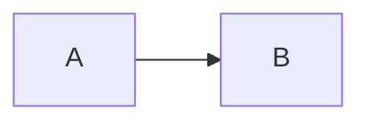
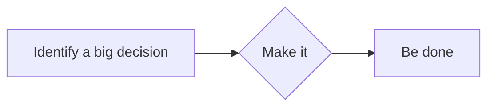
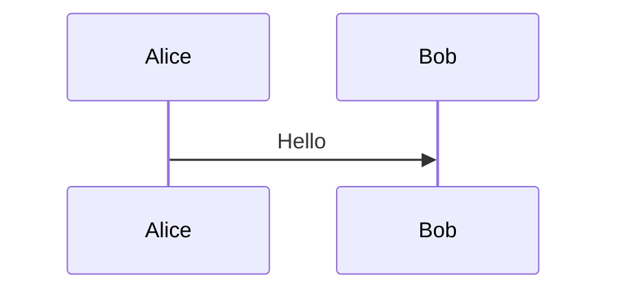
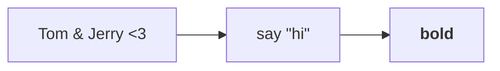
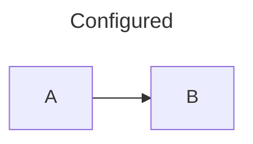
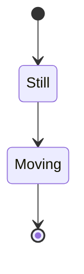
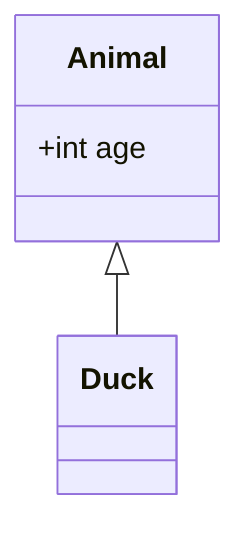
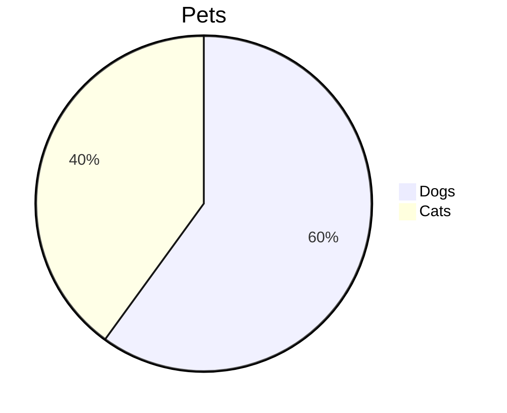
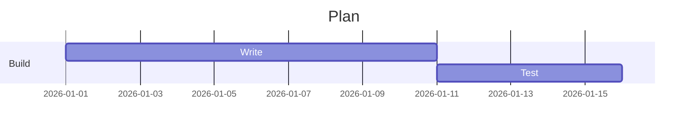

<!-- @case: fence: renders the diagram in place of the code block -->

Before.



After.

<!-- @case: fence: tildes -->

~~~mermaid
flowchart LR
  A --> B
~~~

<!-- @case: fence: words after the language are ignored -->


<!-- @case: untouched: another language -->

```js
const flowchart = "LR";
```

<!-- @case: untouched: the language is case-sensitive -->

```Mermaid
flowchart LR
  A --> B
```

<!-- @case: untouched: a language that starts with mermaid -->

```mermaidjs
flowchart LR
  A --> B
```

<!-- @case: untouched: a fence without a language -->

```
flowchart LR
  A --> B
```

<!-- @case: untouched: indented code -->

Indented:

    flowchart LR
      A --> B

<!-- @case: untouched: inline code -->

`mermaid` and `flowchart LR`

<!-- @case: accessibility: title and description -->



<!-- @case: ids: each diagram gets its own prefix -->




<!-- @case: ids: a repeated diagram counts its repeats -->


<!-- @case: escaping: markup characters are text, and <b> is SVG bold, not HTML -->



<!-- @case: links: safe schemes are kept, scripts are dropped -->


<!-- @case: config: front matter -->



<!-- @case: config: init directive -->


<!-- @case: types: state, class, pie and gantt -->









<!-- @case: nesting: in a blockquote -->

> Quoted:
>
> ```mermaid
> flowchart LR
>   A --> B
> ```

<!-- @case: nesting: in a list item -->

- Item:

  ```mermaid
  flowchart LR
    A --> B
  ```

- Next item
